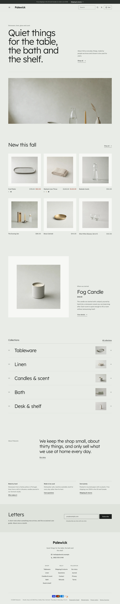

# Marram

Marram is a free storefront theme for **Wave**, the Swell storefront app with a visual editor and an AI agent. It is minimal and airy: a pale fog-gray ground, light, open headings, hairline rules and wide margins, with every product on its own quiet tile. It fits any kind of store.

- Listing copy (the Swell Theme Store page): [`DESCRIPTION.md`](DESCRIPTION.md)
- The installable theme app: [`app/`](app)

## Using it

1. Install Marram from the Swell Theme Store. It is free.
2. Customize it in the Wave editor: click any section or line of text to change it, set fonts, colors, spacing and Marram's own settings in the Theme tab, or ask the AI agent for a change in plain words.
3. Publish when it's ready. Until then every change stays a draft.

Marram reads the store's own Swell data (products, categories, menus, the blog and store details), so set those up in the Swell dashboard first. Shoppers check out on Swell's hosted checkout.

## What's inside

Marram is the minimal and airy one of Swell's free themes; it changes the look, not the store's structure. Its own sections:

- `open_hero`: the home page opening: a large, light heading with a short line and one link, and an optional photo below or beside
- `product_tiles`: products on pale tiles, 2 to 4 per row; on collection and search pages, the count, sort, folded filters and pages
- `product_spotlight`: one product given a whole band
- `collection_index`: categories as a numbered index of large names; also the categories page
- `collection_intro`: a category's opening: its name, description and subcategory links
- `product_focus`: the product page: photo links, the chosen photo large, a narrow column of details that stays in view
- `statement`: one sentence set large
- `text_columns`: up to four short notes side by side

Its own templates are home, product, collection, categories and cart, plus About and Contact page layouts; its own Footer group holds a centered footer. Its theme settings (`theme/config/settings_content.json`) cover: a sticky header; the tiles' second photo on hover, color dots and add button; the quantity box. Its colors, fonts and style choices are in `theme/config/settings.json`.

## How it's built

Marram is built on Swell's shared theme core, like every Wave theme. The core provides the sections every theme has (header, footer, cart, account, search, blog, policies and the rest) and Store text, and every theme must show a Header and a Footer group on every page; Marram adds its own sections, templates, settings and design over it. `app/` is the assembled theme, built from the core and the files here; change Marram's own files and rebuild it, never edit `app/` by hand.

How a section is written, the repository layout and how a theme is assembled are the same for every theme on the core: see the README of Tide, Swell's first free theme.

## License

Marram is licensed under the Swell App License (`LICENSE`), which covers this repository, the shared theme core in `app/` included.
